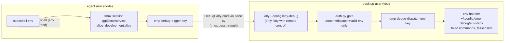

# agent-tools


**Wrappers and bins for running coding agents as a separate user — slice-capped systemd sessions, a machinectl switching shell, and a fail-closed debug channel that lets the agent poke the desktop without ever holding desktop privileges.**

A dotfile-style collection of the small tools I use daily to run AI coding
agents under a dedicated unprivileged user on Arch/Linux. Includes the
scripts in `bin/`, the systemd slices and session template in `systemd/`,
and the gated kitty config in `kitty-debug/`.

## The model

Agents run as user `node` (rename via `NODESHELL_USER`), the desktop session
runs as you. The agent user gets CPU/IO/memory-capped systemd slices and a
one-way control channel to the desktop that can only fire pre-registered,
fixed-command keys — it cannot run arbitrary commands on the desktop side.



## Tools

| Tool | Side | What it does |
|---|---|---|
| `nodeshell [env]` | desktop | `machinectl shell` into the agent user, forwarding display/terminal env (empty vars tolerated). With `env`: attaches to that project's `gg` channel and exports `OMP_DEBUG`; without `env`, a pre-set `OMP_DEBUG` is inherited. |
| `gg@.service` | desktop | systemd user template: one tmux session per project dir, `OMP_DEBUG` set, capped by `development.slice`. `systemctl --user enable --now gg@myproj`. |
| `development.slice` / `development-build.slice` | desktop | CPU weight, IO weight, memory-high and `AllowedCPUs` caps for agent sessions and builds. Tune to your hardware. |
| `omp-debug-kitty [env]` | desktop | Launch the dedicated debug kitty (the only instance with remote control on). With `env`, its window runs `nodeshell env`. |
| `omp-debug-trigger <key>` | agent | Fire a key for the current env. Emits a kitty `@kitty-cmd` DCS to the pane tty (tmux-passthrough-wrapped under tmux). |
| `omp-debug-dispatch <env> <key>` | desktop | Route the key to `~/.config/omp-debug/envs/<env>`. Logs per-env to `/run/user/$UID/omp-debug/dispatch-<env>.log` (user-private runtime dir, not `/tmp`); denials to `dispatch.log` in the same dir. |
| `omp-debug-new-env <env>` | desktop | Stamp a new env handler (`ping`, `restart` template). Edit in place; see `examples/envs/myproj`. |
| `kitty-debug/` | desktop | kitty config + `auth.py`: remote control allows exactly one command shape — background launch of the dispatcher with a registered env and a `[a-z0-9-]` key. |
| `mdrecall <terms…>` | both | Rank existing markdown by topic coverage (frontmatter, headings, body; accent-insensitive) so agents update notes instead of duplicating them. |
| `systemd-urun` | both | Launch a program or open a file via `systemd-run --user` from args, stdin, or clipboard. |
| `git` (wrapper) | both | Safety shim over `/usr/bin/git` for multi-agent worktrees: blocks `reset`, `clean`, and `checkout HEAD --`; warns (with confirmation) when a commit/checkout touches files recently modified by other authors. Everything else passes through. |
| `cargo` (wrapper) | both | Runs cargo in a transient scope inside `development.slice`, forwarding a whitelist of toolchain env vars (`CARGO*`, `RUSTFLAGS`, `PKG_CONFIG*`, proxies, …). Builds can't starve the desktop. |

## Reproduce

```sh
git clone https://github.com/kiran-plasma-ai/agent-tools
cd agent-tools
./install.sh          # desktop side: bins, units, kitty-debug config
```

Then follow the printed agent-side steps (install `omp-debug-trigger`, set
`DESKTOP_HOME` in `~/.config/omp-debug/config`), stamp an env with
`omp-debug-new-env <env>`, and start the day with `omp-debug-kitty <env>`.

Smoke test from inside a `nodeshell <env>` session:

```sh
omp-debug-trigger ping   # desktop: tail /run/user/$(id -u)/omp-debug/dispatch-<env>.log
```

## Operational notes

- **Two users, one channel.** The trigger runs unprivileged as the agent
  user; the security boundary is entirely desktop-side (`auth.py` +
  per-env handlers). Handlers are fixed-command case statements — never
  pass the key through to a shell.
- **Fail-closed, verified in kitty source.** If `auth.py` is missing or
  fails to load, kitty substitutes a checker that denies everything
  (`is_cmd_allowed_loader` → `CMDChecker.__call__ → False`,
  `kitty/remote_control.py`, verified on 0.51.1). A broken gate means no
  remote control, never open remote control.
- **Dispatcher logs stay off `/tmp`.** They live in `/run/user/$UID` so the
  agent user cannot pre-create symlinks that turn desktop-side log appends
  into file writes. Handler authors: outputs meant for the agent (like the
  example's `logs` key) are the one intentional exception.
- **kitty version pin.** The trigger hardcodes `"version":[0,49,2]` in the
  DCS; kitty rejects versions newer than itself. Bump on kitty upgrades.
- **tmux drops raw DCS.** Under tmux the sequence must be wrapped in the
  tmux passthrough form and written to the pane tty, not stdout — the
  trigger handles both cases.
- **Slices are tuned for a 16-thread desktop** (`AllowedCPUs=2-8` for
  sessions, `4-8` for builds). Edit before installing on other hardware.

## Scope

These are personal dotfiles, published as-is: Linux + systemd + kitty +
tmux assumed, no portability layer. `make check` runs syntax checks on all
shell/python (plus shellcheck when installed). `nodeshell <env>` and
`gg@.service` attach to a project's `gg` channel — `gg`/`gg-core` is a
separate project with its own repo; without it, plain `nodeshell` and the
`AGENT_CMD` override on `gg@.service` still work.

## License

MIT — see [LICENSE](LICENSE).
